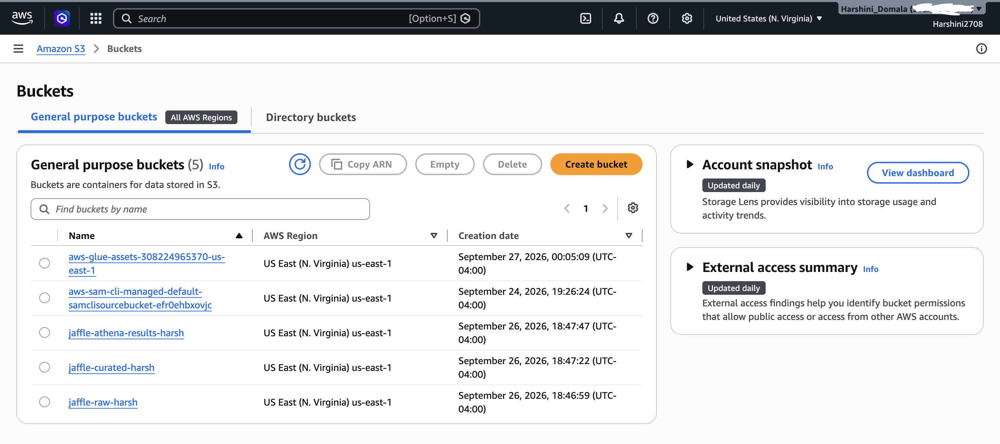
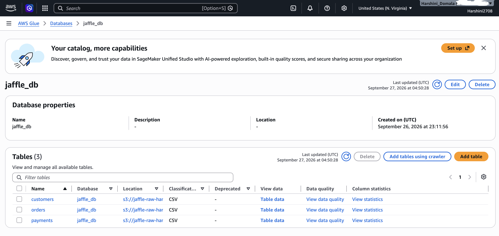
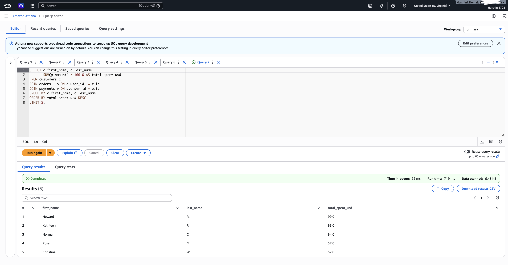
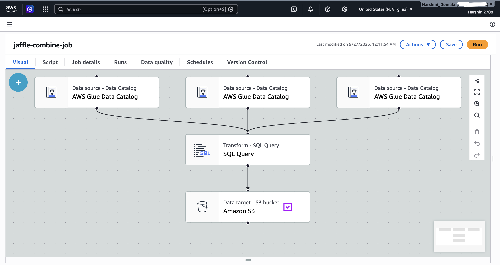
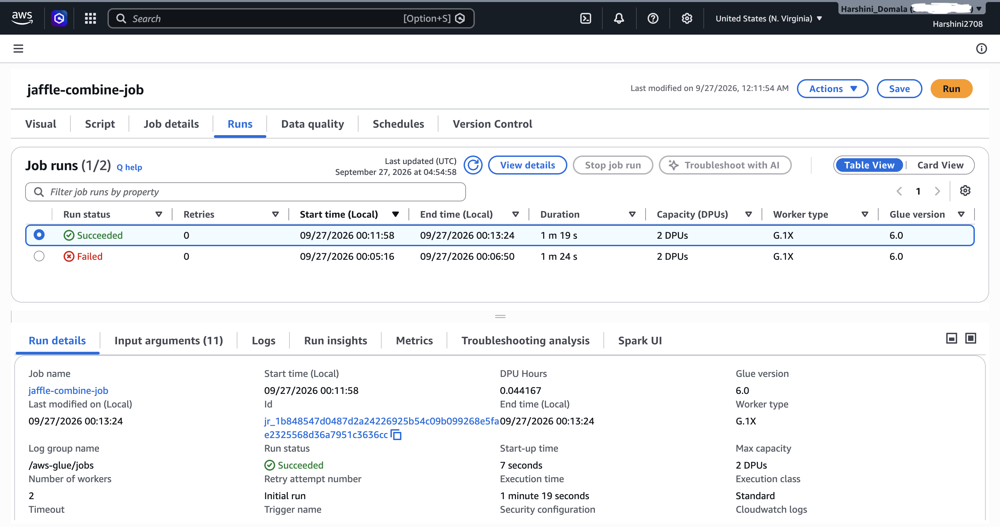
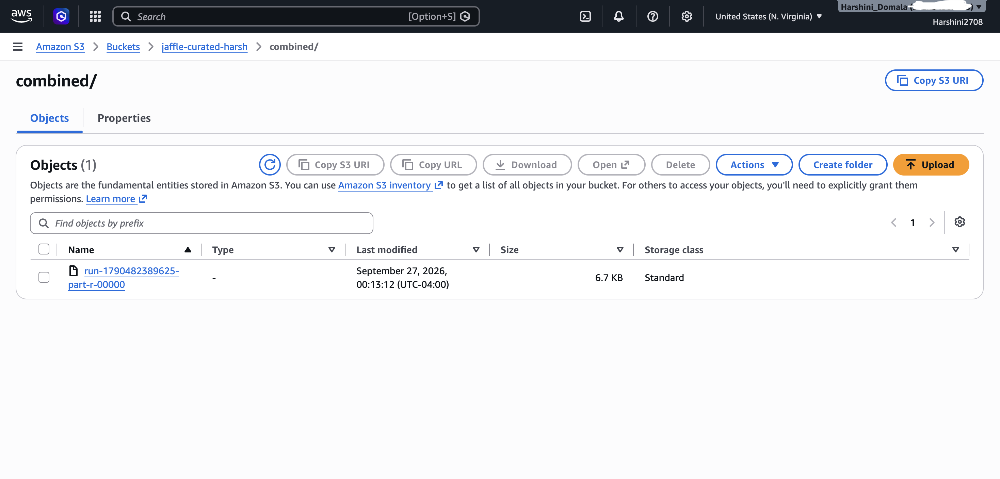

# AWS Serverless Data Pipeline — S3 · Glue · Athena

An end-to-end serverless ETL pipeline on AWS. Three small relational CSV datasets are stored in Amazon S3, cataloged automatically with an AWS Glue Crawler, analyzed with SQL in Amazon Athena, and joined by an AWS Glue (Spark) ETL job into a single curated file written back to S3.

## Architecture

```
┌──────────────────────┐    ┌──────────────┐    ┌─────────────────────────┐
│ S3: jaffle-raw       │    │ Glue Crawler │    │ Glue Data Catalog       │
│  ├─ customers/*.csv  │───►│ (IAM role)   │───►│ jaffle_db               │
│  ├─ orders/*.csv     │    └──────────────┘    │  ├─ customers           │
│  └─ payments/*.csv   │                        │  ├─ orders              │
└──────────────────────┘                        │  └─ payments            │
                                                └───────────┬─────────────┘
                                   ┌────────────────────────┼─────────────────────┐
                                   ▼                                              ▼
                        ┌─────────────────────┐                  ┌──────────────────────────┐
                        │ Amazon Athena       │                  │ Glue ETL job (Spark)     │
                        │ ad-hoc SQL analysis │                  │ 3-table join → 1 file    │
                        └─────────────────────┘                  └────────────┬─────────────┘
                                                                              ▼
                                                                 ┌──────────────────────────┐
                                                                 │ S3: jaffle-curated       │
                                                                 │  └─ combined/ (1 CSV)    │
                                                                 └──────────────────────────┘
```

## Tech stack

| Service | Role in this project |
|---|---|
| **Amazon S3** | Data lake storage: a raw bucket (input), a curated bucket (output), and an Athena results bucket |
| **AWS IAM** | A Glue service role granting the crawler and ETL job access to S3 and the Data Catalog |
| **AWS Glue Crawler** | Scanned the raw bucket, inferred the schemas, and created one table per folder |
| **AWS Glue Data Catalog** | Central metadata store (`jaffle_db`) used by both Athena and the Glue job |
| **Amazon Athena** | Serverless SQL queries directly on the S3 data (schema-on-read) |
| **AWS Glue Studio (Spark)** | Visual ETL job that joins the 3 tables and writes one CSV to the curated bucket |

## Dataset

The [dbt Jaffle Shop](https://github.com/dbt-labs/jaffle_shop) sample data: a fictional shop's customers, orders and payments.

| File | Rows | Columns | Relationship |
|---|---|---|---|
| `raw_customers.csv` | 100 | id, first_name, last_name | — |
| `raw_orders.csv` | 99 | id, user_id, order_date, status | `user_id` → customers.id |
| `raw_payments.csv` | 113 | id, order_id, payment_method, amount | `order_id` → orders.id |

Note: `amount` is stored in cents.

## Steps

### 1. Storage: Amazon S3
- Created three buckets: raw, curated, and Athena query results.
- Uploaded each CSV into **its own folder** (`customers/`, `orders/`, `payments/`), because the Glue crawler creates one table per folder.

### 2. Cataloging: AWS Glue Crawler
- Created an IAM role (`AWSGlueServiceRole-jaffle`) that the Glue service can assume.
- Created the Glue database `jaffle_db`.
- Ran a crawler over the raw bucket root. It detected the CSV format and header rows, inferred the column types, and registered 3 tables.

### 3. Analysis: Amazon Athena
Ran queries directly against S3 via the Data Catalog. See [`sql/athena_queries.sql`](sql/athena_queries.sql).

| Question | Result |
|---|---|
| Row counts | customers 100 · orders 99 · payments 113 |
| Orders by status | completed 67 · shipped 13 · placed 13 · returned 4 · return_pending 2 |
| Revenue by payment method | credit_card $871 · bank_transfer $411 · gift_card $205 · coupon $185 |
| Most orders per customer | Rose M. (5 orders) |
| Top spender | Howard R. ($99.00) |

### 4. Transformation: AWS Glue ETL (Spark)
- Built a visual job in Glue Studio: **3 Data Catalog sources → SQL Query transform → S3 target (CSV)**.
- The join logic is in [`sql/glue_join.sql`](sql/glue_join.sql); the PySpark script Glue generated is in [`glue/jaffle_combine_job.py`](glue/jaffle_combine_job.py).
- The `/*+ COALESCE(1) */` hint merges the result into a single partition, so Spark writes **one output file**.
- Output: **113 rows × 9 columns**, one row per payment, enriched with order and customer details.

## Screenshots

| | |
|---|---|
| S3 raw bucket structure |  |
| Glue Data Catalog tables |  |
| Athena query results |  |
| Glue Studio visual job |  |
| Successful job run |  |
| Curated output in S3 |  |

## Troubleshooting log

| Problem | Cause | Fix |
|---|---|---|
| `s3:CreateBucket` permission denied | The IAM user had no permissions policy attached | Attached `AdministratorAccess` to the IAM user (for learning purposes) |
| Billing console "You need permissions" | IAM access to billing is off by default | Enabled *IAM user and role access to Billing information* as the root user |
| Glue job failed: `TABLE_OR_VIEW_NOT_FOUND: orders` | The SQL Query node's input aliases didn't match the table names used in the SQL | Set the aliases to `customers`, `orders`, `payments` and connected all 3 parent nodes |

## Key concepts learned
- **Schema-on-read:** the data stays as raw files in S3; the catalog applies the structure only at query time.
- **IAM users vs. roles:** a user is a person; a role is an identity an AWS service assumes to act on your behalf.
- **Spark output files:** Spark writes one file per partition, so `COALESCE(1)` produces a single file.
- **Inner vs. left joins:** 38 of the 100 customers have no orders, so an inner join drops them.

## Possible improvements
- Write the output as **Parquet** instead of CSV, to reduce the data Athena scans.
- **Partition** the curated data by `order_month`.
- **Automate** the pipeline with an EventBridge rule or Glue Workflow, triggered when new files land in S3.
- Narrow the IAM role from `AmazonS3FullAccess` to only this project's buckets (least privilege).

## Repository structure
```
.
├── README.md
├── data/
│   ├── raw_customers.csv
│   ├── raw_orders.csv
│   └── raw_payments.csv
├── sql/
│   ├── athena_queries.sql
│   └── glue_join.sql
├── glue/
│   └── jaffle_combine_job.py
├── output/
│   └── combined_orders_payments.csv
└── screenshots/
```
